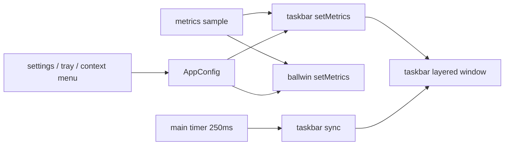

## 产品概述

在现有悬浮球之外，新增「任务栏歌词式」信息显示：网速与内存以透明纯文字常驻 Windows 任务栏通知区域左侧；悬浮球保留，两者可独立开关。新版安装包支持直接覆盖安装旧版。

## 核心功能

- 任务栏显示：透明无底板文字，垂直居中贴在任务栏托盘/时钟左侧；字号随任务栏实际高度自适应，空间不足时自动缩小。
- 显示内容可勾选：下行速度、上行速度、内存占用百分比；全部关闭时不显示；无网络时显示“--”。
- 颜色自适应：深色任务栏用白字、浅色任务栏用深色字，并带轻微反色描边，保证壁纸与系统主题变化下仍可读。
- 双显示切换：设置窗、悬浮球右键菜单、托盘菜单均可开关「显示悬浮球」「在任务栏显示」，选择持久化，重启后保持。
- 自动避让：任务栏自动隐藏时同步隐藏；全屏应用时隐藏；Explorer 重启后自动恢复；文字区域点击穿透，不遮挡任务栏操作。
- 配置兼容：沿用旧版 config.ini，新增配置项缺失时使用默认值，旧设置不丢失。
- 覆盖升级：新版本安装包识别旧版并安装到原安装目录，保留原有配置与开机自启，不产生并存的两套程序。

## 视觉效果

任务栏文字右对齐到托盘时钟左侧，单行排列、无背景底板；深色任务栏上为白色文字，浅色任务栏上为近黑色文字，文字外圈有极淡反色光晕；不闪烁、不引起任务栏布局跳动。

## 技术栈

- 语言与运行时：C++17 + Win32 API + GDI+，无第三方库（沿用 v1.0.0）。
- 编译器与构建：MinGW-w64 g++ 13.1.0 + windres；`build\build.bat` 一键构建，保留 `-Wl,--no-insert-timestamp` 确定性链接。
- 打包：Inno Setup 6.7.3，`build\package.bat` 带产物尺寸与 sha256 双闸门。

## 实现方案

### 1. 任务栏显示形态（关键决策）

不采用 `SetParent` 注入 Explorer 任务栏：Win11 任务栏由 XAML 渲染，跨进程子窗口不稳定，且会触碰 Explorer。改为创建 32bpp 逐像素 alpha 的顶层分层覆盖窗，贴在任务栏上、位于通知区域左侧。视觉上等价于任务栏内文字，但完全不改动 Explorer。

- 窗口：`WS_POPUP`，扩展样式 `WS_EX_LAYERED | WS_EX_TOOLWINDOW | WS_EX_TOPMOST | WS_EX_NOACTIVATE | WS_EX_TRANSPARENT`。
- `WS_EX_TRANSPARENT` 负责点击穿透，不挡任务栏、托盘和任务按钮操作；不抢焦点、不进 Alt+Tab。
- 使用 `UpdateLayeredWindow(ULW_ALPHA)` 提交画面，背景全透明，只绘制文字。
- 复用 `ball_window.cpp` 已验证的 top-down 32bpp DIB + GDI+ PARGB 位图绘制方式，但代码放在新模块内，避免改动悬浮球主链路。

### 2. 定位（托盘区左侧，物理像素）

- `FindWindowW(L"Shell_TrayWnd", nullptr)` 获取任务栏矩形。
- `FindWindowExW(tray, nullptr, L"TrayNotifyWnd", nullptr)` 获取通知区域锚点。本机 Win11 build 26300 实测存在，rect 为 [1567,1186,2194,1234]，父窗口为 `Shell_TrayWnd`。
- 水平任务栏：覆盖窗右边缘 = 锚点 left 减去 8 DIP 间距；高度 = 任务栏高度；文字垂直居中。
- 锚点缺失或矩形异常（宽高过小、与任务栏无交集）时，使用兜底右边界 `taskbar.right - 300 DIP`。
- 纵向任务栏：文字改为多行堆叠（下行/上行/内存各一行），放在锚点上方；宽度不足先缩字号，仍不足则隐藏（记录为已知限制）。
- 所有几何直接使用 `GetWindowRect` 返回的物理像素，只对间距与内边距做 DPI 换算，避免二次缩放。字体像素高度按任务栏实际高度取 `0.36 × 高度`，夹在 10 到 34px，再按可用宽度逐级缩小。

### 3. 文字内容与可读性

- 显示项由 `tbShowDown/tbShowUp/tbShowMem` 独立控制，速度复用 `render::formatSpeed()`。
- 文本形如：`↓ 12.5 MB/s   ↑ 1.2 MB/s   内存 62%`；网络无效时显示 `--`。
- 颜色：`textAuto=TRUE` 时读取 `HKCU\Software\Microsoft\Windows\CurrentVersion\Themes\Personalize\SystemUsesLightTheme`，浅色任务栏用深色字、深色任务栏用白字；`textAuto=FALSE` 时沿用现有 `textColor`。
- 始终绘制 1px 四向反色光晕（低 alpha），保证任意壁纸和任务栏配色下可读；字体沿用 `Microsoft YaHei UI` Bold 与 `TextRenderingHintAntiAliasGridFit`。
- 文字测量与字号收缩只在文本、字体或可用宽度变化时执行，绘制结果做指纹缓存。

### 4. 同步与可见性

- 主消息窗口新增 `TIMER_TASKBAR`（250ms），仅在 `taskbarShow=TRUE` 时执行有效工作。
- `sync()` 重新计算任务栏矩形、锚点、自动隐藏状态与全屏状态；只有文本、颜色、字体或矩形变化时才调用 `UpdateLayeredWindow`。
- 自动隐藏：`SHAppBarMessage(ABM_GETSTATE)` 含 `ABS_AUTOHIDE` 时，按任务栏可见厚度判断，厚度不大于 6px 视为已隐藏，覆盖窗同步隐藏。
- 全屏：`SHQueryUserNotificationState()` 返回 `QUNS_BUSY`、`QUNS_RUNNING_D3D_FULL_SCREEN` 或 `QUNS_PRESENTATION_MODE` 时隐藏覆盖窗。
- Explorer 重启：覆盖窗和托盘各自处理 `TaskbarCreated`；覆盖窗收到后重新查找任务栏并重申 `HWND_TOPMOST`。
- 前台窗口为 `Shell_TrayWnd` 时轻量重申置顶，避免任务栏被激活后把文字压到下面；Start 菜单或通知中心打开时不重申，避免盖住系统 UI。
- 任务栏窗自身处理 `WM_SETTINGCHANGE`、`WM_DISPLAYCHANGE`、`WM_DPICHANGED`，收到后立即 `sync()`。

### 5. 配置与交互

- `AppConfig` 末尾追加 5 个字段：`showBall`（默认 TRUE）、`taskbarShow`（默认 TRUE，升级后立即可见）、`tbShowDown`（TRUE）、`tbShowUp`（TRUE）、`tbShowMem`（FALSE）。
- `config.cpp` 增加 5 个 ini 键：`showball`、`taskbarshow`、`tbshowdown`、`tbshowup`、`tbshowmem`；缺失时回落默认值，旧版 15 键配置可直接加载。
- 设置窗新增两行：「悬浮球 / 在任务栏显示」与「任务栏显示项：下行 / 上行 / 内存」；客户区高度 456 增至 532 DIP，按钮整体下移，1080p@175% 仍可完整显示。
- 悬浮球右键菜单与托盘菜单新增「在任务栏显示」开关，命令 ID `IDM_TASKBAR=1007`，带勾选态；托盘菜单通过新增状态设置函数保持勾选同步。
- 「显示或隐藏」改为持久化 `showBall`；球隐藏时托盘图标、设置窗与任务栏文字仍可用。
- 球窗口与任务栏文字同时关闭时，程序退化为仅托盘图标，不退出进程。

### 6. 覆盖升级安装（1.0.0 到 1.1.0）

- 保持固定 `AppId = {{8F3A1C2E-5B47-4D9A-9E62-0C7D4B15A8E3}}`，这是 Inno 识别同一产品并执行升级而非并存的唯一依据，严禁改动。
- 显式设置 `UsePreviousAppDir=yes`，升级沿用原安装目录；保留 `CloseApplications=yes` 关闭正在运行的旧版，保留 `RestartApplications=no` 避免静默拉起。
- 新增 `[Code] CurStepChanged(ssPostInstall)`：若 `HKCU\Software\Microsoft\Windows\CurrentVersion\Run\NetBall` 存在，改写为新 `{app}\NetBall.exe` 路径，防止安装目录变化后自启失效。
- 版本统一升到 1.1.0：`src\app_common.h`、`src\app.rc`、`src\app.manifest`、`installer\NetBall.iss`、`build\package.bat`、`assets\installer\README.txt` 同步更新；产物名 `dist\NetBallSetup-1.1.0.exe`。
- `%APPDATA%\NetBall\config.ini` 原样保留；新版加载旧配置后自动补默认新键。

## 性能与可靠性

- 覆盖窗 DIB 约 600×48×4 约 115KB；250ms 定时器只做少量 Win32 查询，文本未变时不重绘，CPU 增量远低于既有 0.5% 红线。
- 失败兜底：找不到任务栏、锚点异常、文字为空时隐藏窗口而非崩溃；`UpdateLayeredWindow` 失败时保留上一帧。
- 影响面控制：`ball_window.cpp` 的绘制与拖动逻辑不动，只增加一个菜单项和 `WM_CLOSE` 处理；`render.cpp` 不改，任务栏文字绘制放在新模块内，只复用公开的 `formatSpeed`。
- 无新增第三方依赖，exe 体积与内存占用增量有限，仍满足 exe 不大于 2MB、稳态 WS 不大于 15MB 的既定红线。

## 架构设计



`main.cpp` 仍是唯一主控与定时器宿主；`taskbar` 新模块只负责任务栏覆盖窗；`cfg` 负责新增键持久化；`settings_ui` 与 `tray` 只改 UI 和命令入口。

## 目录结构

```
网速悬浮球/
├── src/
│   ├── taskbar_text.h          # [NEW] 任务栏覆盖窗对外契约。声明 taskbar 命名空间的 create/destroy/applyConfig/setMetrics/sync/hwnd，补充窗口类名、定时器、命令 ID 约定。
│   ├── taskbar_text.cpp        # [NEW] 任务栏覆盖窗实现。任务栏查找与锚点定位、32bpp DIB 与 UpdateLayeredWindow、GDI+ 透明文字与光晕、字号自适应、自动隐藏/全屏/Explorer 重启同步、点击穿透窗口样式。
│   ├── app_common.h            # [MODIFY] 契约扩展。新增 WND_CLASS_TASKBAR、TIMER_TASKBAR、IDM_TASKBAR；AppConfig 追加 showBall/taskbarShow/tbShowDown/tbShowUp/tbShowMem；新增 namespace taskbar 声明；NETBALL_VERSION_STR 改为 1.1.0。
│   ├── config.cpp              # [MODIFY] 配置持久化。新增 5 个键的默认值、读取校验、保存写入；保持旧配置缺失键回落默认。
│   ├── main.cpp                # [MODIFY] 主控集成。创建/销毁任务栏窗、启动时按 showBall 隐藏球、新增 TIMER_TASKBAR 同步、SampleOnce 推送任务栏指标、IDM_TASKBAR 命令、ApplyNow 联动、退出清理。
│   ├── tray.cpp                # [MODIFY] 托盘菜单。新增「在任务栏显示」勾选项及状态设置函数；「显示或隐藏」改为持久化 showBall。
│   ├── ball_window.cpp         # [MODIFY] 球右键菜单。新增「在任务栏显示」勾选项；补充 WM_CLOSE 处理，保证覆盖安装时 Restart Manager 能正常关闭进程。
│   ├── settings_dialog.cpp     # [MODIFY] 设置窗。新增「悬浮球/在任务栏显示」与「任务栏显示项：下行/上行/内存」两行控件；调整 ComputeGeo、State、CreateControls、RefreshAll、WM_COMMAND，客户区 456 改为 532 DIP。
│   ├── app.rc                  # [MODIFY] 版本资源。FILEVERSION/PRODUCTVERSION 改 1,1,0,0；FileVersion/ProductVersion 改 1.1.0.0；IDS_VERSION 改 1.1.0。
│   └── app.manifest            # [MODIFY] assemblyIdentity version 改为 1.1.0.0。
├── build/
│   ├── build.bat               # [MODIFY] 编译单元列表加入 taskbar_text.cpp；保持纯 ASCII。
│   └── package.bat             # [MODIFY] OUTEXE 改 NetBallSetup-1.1.0.exe；重建后分两步更新 EXPECT_SIZE 与 EXPECT_SHA；保持纯 ASCII。
├── installer/
│   └── NetBall.iss             # [MODIFY] 版本与产物名改 1.1.0；显式 UsePreviousAppDir=yes；新增 CurStepChanged 修复 HKCU Run 自启路径；保持 UTF-8 with BOM。
├── assets/installer/
│   └── README.txt              # [MODIFY] 版本号更新；补充任务栏显示功能、显示项开关与覆盖升级说明；保持 UTF-8 BOM 与全 CRLF。
└── docs/
    └── v1.1.0-变更与升级说明.md # [NEW] 记录新功能、新增配置键、覆盖升级步骤、验证结论与已知限制；不改写 v1.0.0 历史验收数据。
```

## 关键代码结构

```cpp
struct AppConfig {
    // ... 现有 15 个字段保持不变 ...
    BOOL showBall;     // 显示悬浮球
    BOOL taskbarShow;  // 在任务栏显示
    BOOL tbShowDown;   // 任务栏显示下行
    BOOL tbShowUp;     // 任务栏显示上行
    BOOL tbShowMem;    // 任务栏显示内存
};

namespace taskbar {
    bool create(HINSTANCE hInst, const AppConfig* c);
    void destroy();
    void applyConfig(const AppConfig* c);
    void setMetrics(const Metrics* m);
    void sync();       // 几何、可见性、主题同步
    HWND hwnd();
}
```

## 实施注意

- DPI：几何全部来自 `GetWindowRect` 物理像素，只对间距做 DPI 换算；字体按任务栏实际像素高度计算，避免二次缩放。
- 定位：优先 `TrayNotifyWnd`，必须实现 `taskbar.right - 300 DIP` 兜底；锚点矩形需校验宽高与交集，防止异常坐标把窗口丢到屏外。
- 点击穿透：必须同时具备 `WS_EX_LAYERED` 与 `WS_EX_TRANSPARENT`；文字区域不接收鼠标，所有开关入口放在球菜单、托盘菜单与设置窗。
- 自动隐藏：任务栏不可见时覆盖窗必须隐藏；`ABM_GETSTATE` 不可用时退化为按任务栏矩形与显示器边界判断厚度。
- 定时器：250ms 只做查询与比较，文本未变不重绘；任务栏功能关闭时定时器回调立即返回。
- 文件编码：`build\*.bat` 保持纯 ASCII；`installer\NetBall.iss` 保持 UTF-8 with BOM；README 保持 UTF-8 BOM 与 CRLF，避免 cmd 与安装器中文乱码。
- 安装升级：AppId 必须原样保留；`UsePreviousAppDir=yes` 与 `CloseApplications=yes` 必须保留；升级测试使用 `/CURRENTUSER /VERYSILENT /SUPPRESSMSGBOXES /TASKS=""` 覆盖旧版，断言同一卸载条目、同一安装目录、配置保留、自启路径有效、无重复进程。
- 打包锚点：`build.bat` 产出新 exe 后先计算 size 与 sha256，再回填 `package.bat`，最后执行打包并确认 `RESULT: OK`，禁止用旧哈希强行打包。
- 回归范围：悬浮球的形状、透明度、文字对比度、拖动与位置记忆、单实例、托盘菜单、配置往返均不得回归。