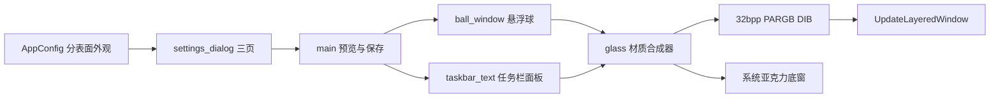

## 用户需求

取消现有「常规」页，把外观设置合并进「任务栏」和「悬浮球」两页，两个表面各自独立调节；重做悬浮球与任务栏面板的材质，使亚克力、玻璃、液态玻璃呈现真实透明与材料质感，修复胶囊变矩形、材质不透明、模糊缺失的问题。

## 产品概述

NetBall 是任务栏网速面板与桌面悬浮球的双表面小工具。本次改版让两个表面拥有各自独立的形状、尺寸、颜色、浓度、文字色、材质、模糊、圆角、描边与高光；材质不再是纯色遮罩，而是带背景模糊、透光、颗粒、高光、边缘折射的“材料”。设置窗口改为「任务栏 / 悬浮球 / 数据」三页，调整时能直接看到真实表面变化。

## 核心功能

- 任务栏与悬浮球的外观参数完全分开持久化，互不影响。
- 提供纯色、亚克力、玻璃、液态玻璃、无底板 5 档材质，并额外提供实验性的系统实时亚克力开关。
- 亚克力呈现磨砂颗粒、柔和内阴影与厚重模糊；玻璃呈现清透透光、镜面高光与边缘折射；液态玻璃呈现更强折射、高光带与轻微色散。
- 所有材质形状精确：胶囊保持胶囊，圆角方保持圆角方，椭圆保持椭圆；形状外完全透明。
- 材质在纯色桌面上也能看出质感，不依赖背景细节。
- 设置页控件随 DPI 与窗口缩放正确重排，不重叠、不裁切；调整时悬浮球不被设置窗完全遮挡。
- 旧配置升级后不丢失当前颜色、材质、排版与位置。
- 保持低开销：数值刷新不重复抓屏，材质只在必要时机重算。

## 技术栈

- C++17 / Win32 / GDI+，MinGW-w64 g++ 13.1.0，沿用 `build/build.bat`，不引入第三方库。
- 绘制继续使用 32bpp top-down DIB 与 `UpdateLayeredWindow(ULW_ALPHA)`，像素格式为 `PixelFormat32bppPARGB`。
- 配置继续使用 `%APPDATA%\NetBall\config.ini`，由 `src/config.cpp` 读写。
- 自绘材质完全独立于 DWM；DWM accent 仅用于可选的系统实时亚克力路径。

## 实现策略

- 将 `src/glass.h` / `src/glass.cpp` 重构为“按表面材质合成器”：负责背景抓取、模糊、色调、透射、颗粒、高光、折射、形状遮罩与缓存。
- 新增 header-only 的 `src/surface_shape.h`，统一椭圆、圆角方、胶囊的路径与 SDF 距离函数，供 `render.cpp`、`glass.cpp`、`taskbar_text.cpp` 共用，避免形状与圆角在各处不一致。
- 配置从“全局外观 + 少量分表面字段”改为“全部外观按表面独立”，保留旧键用于迁移与降级。
- 设置窗口由四页改为三页，使用 `SurfaceGeo` / `SurfaceControls` 复用两套表面控件布局，避免任务栏页与悬浮球页各写一份坐标。

## 材质引擎设计

### 1. 背景抓取

- 抓取区域为表面矩形向外扩张 `2 × 模糊半径 + 8px`，避免边缘模糊出现暗边；离屏部分用边缘像素延拓。
- 抓屏前隐藏自身窗口；调用 `DwmFlush()` 等待合成，失败时回退 `Sleep(16)`；随后 `BitBlt`，再恢复原可见性。
- 首次绘制发生在窗口显示前，因此首次抓屏无闪烁；后续只在矩形、壁纸、主题、DPI、显示器变化时重抓。
- 优先 `CreateDC(L"DISPLAY")`，失败回退 `GetDC(NULL)`；按虚拟屏坐标裁剪，支持负坐标与多显示器。

### 2. 高斯模糊

- 使用 3 次可分离盒式模糊逼近高斯，按 sigma 计算盒半径；每像素每遍 O(1)，400×400 表面耗时控制在 10ms 内。
- 大半径时先降采样再模糊、再双线性放大，降低大球体耗时。
- 原始背景、模糊背景、最终材质分三层缓存：色调/浓度变化复用模糊结果；模糊半径变化只重算模糊，不重抓屏。

### 3. 合成与质感

- 输出统一为预乘 ARGB：先模糊，再做饱和度增强、色调混合、透射 alpha、颗粒、边缘折射、SDF 高光/内阴影/描边，最后预乘。
- 纯色：按浓度填充色调，复用 `surface_style` 的描边与高光。
- 亚克力：重模糊，浓度作为磨砂色调，叠加细颗粒、顶部柔光、底部内阴影、1px 内亮边；透射 alpha 约 0.92-0.98，保证仍能感知背景。
- 玻璃：中等模糊，透射 alpha 约 0.55-0.80；边缘 6-10px 做向外/向内的折射采样，叠加斜向镜面高光带、亮边与底部内阴影。
- 液态玻璃：更强边缘折射（10-16px）、更亮的高光带与边缘辉光、轻微色散；高光相位随重绘推进，复用已有模糊结果，不额外起定时器。
- 无底板：形状内 alpha 为 0，只保留可选描边/高光与文字。
- 自动文字色按表面色调与浓度计算；玻璃、液态玻璃、无底板强制加文字阴影/光晕，保证可读性。

### 4. 形状与遮罩

- 形状 0=椭圆，1=圆角方，2=胶囊；圆角方使用该表面独立的 `cornerPx`，胶囊半径固定为短边一半。
- 遮罩用 SDF 计算覆盖率，抗锯齿；材质填充、描边、高光、文字区域全部使用同一套形状与圆角。
- 任务栏胶囊面板左右内边距按端部圆弧内缩，避免文字贴边；圆角方文字区域也做轻微内缩。

### 5. 缓存与失效

- 抓屏缓存键：表面矩形、扩展边距、DPI、背景代次。
- 模糊缓存键：抓屏代次、模糊半径、DPI。
- 材质缓存键：模糊代次、材质类型、色调、浓度、圆角、形状、描边、高光、DPI、尺寸。
- 数值刷新只命中材质缓存并 memcpy；参数滑块只重算材质；移动/换壁纸/换主题/改 DPI 才重抓屏。
- 抓屏失败时回退为“浓度色调 + 形状遮罩 + 描边”，绝不出现空白面板。

## 系统实时亚克力

- 仅在材质为亚克力、用户开启开关且 `acrylicAvailable()` 为真时启用。
- 继续使用独立非分层底窗，但修复顺序：先 `ApplyAccent`，再 `SetWindowRgn`；每次 `SetWindowPos`、显示、移动后重新设置 region，保证胶囊/圆角不被重置为矩形。
- 文字层 DIB 不再填充材质底色，只画文字与描边/高光，避免双层色调叠加导致不透明；底窗 accent 的 nColor alpha 使用浓度。
- 底窗紧贴文字层之下，两者都置顶；不使用时应立即隐藏，退出时销毁。
- Win11 非激活窗口的 accent 亚克力可能退化为纯色，UI 标注“实验性”；不可用或失败时自动回退自绘亚克力，不出现空白。

## 分表面接入

### 悬浮球

- `ball_window.cpp::PaintNow` 严格按 `ballW/ballH` 设置窗口尺寸，移除“只增不减”的旧逻辑，避免胶囊宽高比失真。
- 先按 `ballShape/ballCorner/ballBlur/ballTint/ballTintAlpha/ballBorder/ballSheen/ballMat/ballSysAcrylic` 构造 `MaterialSpec`，调用 `glass::paint` 写入 DIB；再调用新增的 `render::drawBallTextEx` 只画文字。
- `render.cpp` 的完整绘制路径保留给契约兼容；新增文字专用路径，不再在材质之上重复填色或叠加高光。
- 拖动时材质随窗口移动；拖动结束调用 `invalidateBackdrop(1)` 后重绘。`WM_THEMECHANGED`、`SPI_SETDESKWALLPAPER`、`WM_DISPLAYCHANGE`、`WM_DPICHANGED` 均使背景失效。
- 系统亚克力开启时先 `placeSystemAcrylic`，成功则文字层用无底板模式；失败立即回退自绘。

### 任务栏面板

- `PanelLayout` 增加 `shape`、`cornerPx`、`blurPx`、`border`、`sheen`、`sysAcrylic`，全部来自 `tb*` 字段；缓存键同步扩展。
- `ApplyLayout` 先定位窗口，再调用 `glass::paint` 生成材质，`PaintPanel` 只画文字。
- 删除 `mat==1 && !useAcrylic` 时不画底板的空白路径；系统亚克力不可用时回退自绘。
- `applyConfig` 不再无条件 `invalidate` 与重置宽度高水位；只有矩形、排版、字号、DPI 变化才重置，外观滑块变化只重算材质。
- 主题、DPI、Explorer 重启、壁纸变化时 `invalidateBackdrop(0)`。

## 配置模型与迁移

- `AppConfig` 新增：
- `tbShape`（1 圆角方 / 2 胶囊）、`ballShape`（0 圆 / 1 圆角方 / 2 胶囊）
- `tbBlur`、`ballBlur`、`tbCorner`、`ballCorner`
- `tbBorder`、`ballBorder`、`tbSheen`、`ballSheen`
- `tbTextAuto`、`tbTextColor`、`ballTextAuto`、`ballTextColor`
- `tbSysAcrylic`、`ballSysAcrylic`
- `tbMat` / `ballMat` 扩展为 0 纯色、1 亚克力、2 玻璃、3 液态玻璃、4 无底板。
- 新增 `cfgver=2`。读取时若 `cfgver` 缺失按旧版迁移：
- 旧 `shape` → `ballShape`，`tbShape` 默认 1。
- 旧 `matBlur/matCorner/matBorder/matShadow` → 同时填充任务栏与悬浮球。
- 旧 `textAuto/textColor` → 同时填充两个表面。
- 旧 `mat==3`（无底板）映射为新值 4；旧 0/1/2 保持不变。
- 旧悬浮球纯色配置的 `bgcolor/opacity` → `ballTint/ballTintAlpha`。
- 保存时写新键与 `cfgver=2`，同时回写旧键用于降级：`shape=ballShape`、`matblur=ballBlur`、`matcorner=ballCorner`、`matborder=ballBorder`、`matshadow=ballSheen`、`textauto/textcolor/bgcolor/opacity` 取悬浮球值；旧材质值将液态玻璃映射为玻璃、无底板映射为 3。
- `layout_model::defaults` 与 `clampConfig` 按表面分别校验；无效控件在 UI 中置灰，但保留其值。

## 设置界面重构

- 页签改为「任务栏 / 悬浮球 / 数据」，页索引常量为 `PAGE_TB=0`、`PAGE_BALL=1`、`PAGE_DATA=2`；所有 `CommitSpec`、`ListOp`、`WorkingSpec`、`ShowAddMenu` 按新常量更新。
- 任务栏页：显示开关、排版列表与 6 个操作按钮、字号/行距/间距、形状（圆角方/胶囊）、颜色、浓度、5 张材质卡、模糊、圆角、自动文字色与文字颜色、描边、高光、系统亚克力开关、说明。
- 悬浮球页：显示开关、排版列表与 6 个操作按钮、字号/行距/间距、宽/高、形状（圆/圆角方/胶囊）、颜色、浓度、5 张材质卡、模糊、圆角、自动文字色与文字颜色、描边、高光、系统亚克力开关、说明。
- 数据页：刷新频率、温度数据源 5 张卡、GPU 只读文本框与重新探测、系统亚克力能力提示、说明。
- 两页外观控件采用两列紧凑布局：字号与行距、间距与宽高（球）、模糊与圆角成对放置；材质卡一行 5 张。目标在 520×680 DIP 内不裁切；若实测仍溢出，给页面内容加垂直滚动，页签与底部按钮固定。
- 用 `SurfaceGeo` 与 `SurfaceControls` 复用两页布局与控件指针；`State.ctrls` 容量提升到 192。
- 删除常规页的形状/背景色/不透明度/文字色/刷新/双预览，删除旧的假材质预览；设置窗口改为优先放在悬浮球左侧或右侧并钳制到工作区，让真实悬浮球与任务栏面板承担预览。
- 系统亚克力仅当选中亚克力时可勾选；纯色/玻璃/液态玻璃/无底板时置灰。模糊/圆角/浓度对无底板等无效组合置灰。
- 保留现有深色自绘、owner-draw 按钮、DPI 重建、底部按钮固定等约定。

## 性能与可靠性

- 稳态不产生额外定时器；材质只在参数或背景变化时重算；数值刷新仅 memcpy。
- 最坏 400×400 球体加扩展边距，三层缓存合计约 2-3MB；任务栏面板更小。
- 所有窗口操作在 UI 线程；抓屏时恢复原可见性，隐藏状态不被重绘意外显示。
- 所有 GDI/GDI+ 对象成对释放；配置读取做范围校验；抓屏或 DWM 调用失败均有回退。
- 不引入后台线程、网络、管理员权限或第三方依赖。

## 架构设计



## 目录结构

```
src/
├── app_common.h          # [MODIFY] AppConfig 增加分表面外观字段；更新契约注释
├── config.cpp            # [MODIFY] cfgver=2、新键读写、旧键迁移、降级回写、默认值
├── layout_model.cpp      # [MODIFY] defaults 与 clampConfig 按表面校验新字段
├── glass.h               # [MODIFY] 新 MaterialSpec 与材质/系统亚克力接口
├── glass.cpp             # [MODIFY] 重写：抓屏、DwmFlush、高斯模糊、合成、缓存、底窗修复
├── surface_shape.h       # [NEW] header-only 形状路径与 SDF，render/glass/taskbar 共用
├── render.h              # [MODIFY] 新增 drawBallTextEx；说明材质由 glass 负责
├── render.cpp            # [MODIFY] 使用 ballShape/ballCorner；拆分完整绘制与文字绘制
├── ball_window.cpp       # [MODIFY] 新材质管线、精确尺寸、系统亚克力开关、背景失效
├── taskbar_text.cpp      # [MODIFY] 新材质管线、tbShape/tbCorner/tbBlur、删除空白回退
├── settings_dialog.cpp   # [MODIFY] 三页重构、SurfaceGeo/SurfaceControls、全外观控件、窗口侧置
└── settings_dialog.h     # [MODIFY] 仅更新维护说明，不改对外签名
```

不新增 .cpp，`build/build.bat` 源文件列表保持不变；不修改版本号、安装包脚本与 docs。

## 关键代码结构

```cpp
namespace glass {
enum MaterialType { MAT_SOLID = 0, MAT_ACRYLIC = 1, MAT_GLASS = 2, MAT_LIQUID = 3, MAT_NONE = 4 };

struct MaterialSpec {
    int      type;
    int      shape;          // 0 椭圆 1 圆角方 2 胶囊
    int      cornerPx;
    int      blurPx;
    COLORREF tint;
    int      concentration;  // 0..100
    BOOL     border;
    BOOL     sheen;
    BOOL     systemAcrylic;  // 仅亚克力有效
};

bool paint(int slot, HWND self, const RECT&amp; screenRect, const MaterialSpec&amp; spec,
           int dpi, BYTE* bits, int stride, int w, int h);
bool placeSystemAcrylic(int slot, HWND owner, HWND textHwnd, const RECT&amp; screenRect,
                        const MaterialSpec&amp; spec, int dpi);
bool acrylicAvailable();
void hideSystemAcrylic(int slot);
void invalidateBackdrop(int slot);
void destroy();
}
```

## 验证方案

- 运行 `build\build.bat`，确认零错误、零警告。
- 形状验证：对材质 1/2/3 与形状 2 的球做“显示/隐藏”帧差，胶囊覆盖率约 0.857、10% 高度处内缩约 0.133；若亚克力底窗仍为矩形，帧差会明显超出胶囊轮廓，此项必须通过。
- 模糊与透明验证：在高对比背景前分别截图纯色、亚克力、玻璃；纯色内部方差接近 0，亚克力/玻璃内部应有非零且低于原始背景的方差；玻璃应能看到轻微 sharper 背景透出。
- 分表面验证：任务栏设为红色、悬浮球设为蓝色，分别截图，确认互不影响；任务栏切胶囊、悬浮球保持圆形。
- 设置页验证：在 96/144/168 DPI 与 520×680 最小窗口下截图三页，确认无重叠、无裁切、无控件跑到错误页；窗口放大后列表与说明区正常扩展。
- 系统亚克力验证：开启后确认胶囊 region 不被重置为矩形、无崩溃；关闭系统透明效果或接口不可用时确认自动回退自绘材质。
- 稳态验证：静置 10 秒，确认没有持续重绘导致的 CPU 占用；材质滑块预览应只重算材质，不反复抓屏。

## 风险与取舍

- 自绘材质基于抓屏烘焙，不逐帧跟随视频背景；移动、换壁纸、改配置时重算。UI 说明中明确这一点，以换取形状精确与低 CPU。
- `DwmFlush` 抓屏可能带来一帧闪烁；通过“首次显示前抓取 + 原始背景缓存 + 参数变化只重合成”把闪烁降到最低。
- Win11 非激活窗口的系统亚克力可能退化为纯色，这是系统行为；该选项标注实验性，默认关闭，失败即回退自绘。
- 三页紧凑布局可能在高 DPI 小屏上溢出；以 520×680 为硬约束设计，必要时加页面级滚动，且页签与底部按钮固定。
- 配置字段与设置页 ID 改动面较大；用 `cfgver` 迁移、保留旧键、集中 `SurfaceGeo` 布局与 `clampConfig` 降低回归风险。

## 设计风格

沿用现有深色原生设置窗，保持克制、清晰、低干扰的专业工具气质。三页签「任务栏 / 悬浮球 / 数据」横向排列，当前页用蓝色下划线标识；内容区采用紧凑两列布局，成对滑块并排，材质卡一行五张。设置窗优先放在悬浮球侧边，让真实悬浮球与任务栏面板成为实时预览，不再使用假的预览块。

## 页面结构

- 任务栏页：显示开关、排版列表与操作按钮、字号/行距/间距、形状、颜色/浓度、五张材质卡、模糊/圆角、文字色、描边/高光、系统亚克力开关、说明。
- 悬浮球页：显示开关、排版列表与操作按钮、字号/行距/间距、宽/高、形状、颜色/浓度、五张材质卡、模糊/圆角、文字色、描边/高光、系统亚克力开关、说明。
- 数据页：刷新频率、温度数据源、GPU 只读列表与重新探测、能力提示、说明。

## 交互与视觉

- 材质卡选中时使用蓝色描边与柔和底色，未选中为深灰面板；无效控件置灰但保留值。
- 滑块值实时显示在右侧，材质/形状变化立即作用到真实表面。
- 亚克力呈现磨砂颗粒与柔和内阴影；玻璃呈现清透高光与边缘折射；液态玻璃呈现更强折射与高光带。三种材质在纯色桌面上也要有可见的光照与纹理层次。
- 页面切换、DPI 变化、窗口缩放时控件重排；最小 520×680 DIP，超出时内容区滚动，页签与底部按钮固定。