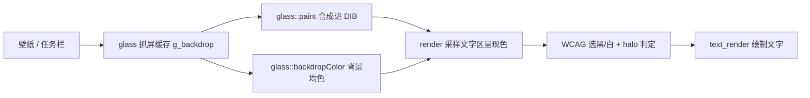

## 产品概述

修复「自动文字色」在深色背景上仍选黑字的问题，使悬浮球与任务栏面板的文字颜色跟随真实画面明暗自动切换，保证任何壁纸/任务栏底色下都清晰可读。

## 核心功能

- 自动文字色以**实际合成画面**为依据：材质模糊、透明度、色调、壁纸、任务栏底色全部计入，深色背景显示白字，浅色背景显示黑字。
- 覆盖悬浮球与任务栏面板两处表面；「无底板」时直接按球体下方的壁纸明暗判定。
- 壁纸更换、球体移动、材质/透明度/色调调整后自动重新判定，无需重启。
- 手动文字色、自动开关关闭时行为完全不变，不产生额外采样开销。
- 采样不可用（如系统亚克力、抓屏失败）时保留原有判定作为兜底，不出现无文字或崩溃。
- 文字仍按实际对比度决定是否加反色柔光，深色/花色背景上边缘依旧清晰。

## 视觉结果

同一浅色球体放在深色壁纸上时文字由黑变白；放在浅色壁纸上仍为黑；任务栏面板在深色任务栏上显示白字，在浅色任务栏上显示黑字。

## 技术栈

- 语言/构建：C++17 + Win32 + GDI+，沿用 `build/build.bat`（MinGW-w64 g++ 13.1.0），不新增第三方依赖。
- 复用现有 `glass`（抓屏/模糊/材质合成）与 `render`（WCAG 对比度/文字绘制）分层，不引入新架构。

## 实现思路

核心问题：`render::autoTextColor(bg, alpha)` 只把「tint × 不透明度」合成到纯黑/纯白桌面做 maximin，与实际 `glass.cpp CompositePixels` 的材质公式不一致（玻璃/液态玻璃的 `tintMix` 与 `baseAlpha` 不同、无底板根本不画底色），且从不看真实壁纸，因此浅 tint + 深色壁纸会选黑字。

方案：**文字绘制前，对已经合成好的表面像素做采样**，结合玻璃层提供的背景均色还原「实际呈现色」，再用 WCAG 选黑白：

1. `glass::paint` 已把材质写进 DIB、文字后画，天然满足「先采样后绘制」，无需改绘制顺序。
2. 呈现色公式（预乘 BGRA）：`displayed = premultRGB + backdrop × (1 − alpha)`。逐像素累加后取均值，既覆盖纯色低透明度，也覆盖无底板（premult≈0 → 直接等于壁纸色）。
3. 采样区域取文字块矩形（球体/面板中心），避开描边与顶部高光；区域先夹到 DIB 边界内。
4. 选色规则：`contrast(black, C) >= contrast(white, C) ? black : white`；halo 判定改为 `真实对比度 < 7.5`（保留 mat=2/3/4 强制 halo 的既有观感）。
5. 兜底：无表面像素且无背景色、或采样覆盖不足时，回退现有 `autoTextColor`；`app_common.h` 契约保留不动。

背景均色来源（新增 `glass::backdropColor`）：

- 亚克力/玻璃/液态玻璃：直接读已有 `g_backdrop` 缓存，O(1)。
- 纯色/无底板：按需复用 `CaptureBackdrop`（含形状掩码补全，能抹掉球体与文字）抓一帧，并把均色存入 `BackdropCache`；矩形不变则复用，不重复抓屏。
- 现有失效路径不变：拖动结束、`WM_SETTINGCHANGE(SPI_SETDESKWALLPAPER)`、主题/DPI/显示器变化、Explorer 重启都会 `invalidateBackdrop` 并重绘，颜色自动跟随。

## 架构设计



## 关键代码结构

```cpp
// render.h（新增，旧 autoTextColor 保留为兜底）
struct TextBackdrop {
    COLORREF color;   // 文字区域背后的实际背景均色
    BOOL     valid;
};

// 采样已合成表面（32bpp 预乘 BGRA，top-down）文字区域的实际呈现色
bool samplePresentedColor(const BYTE* bits, int stride, int w, int h,
                          const RECT& area, const TextBackdrop* backdrop,
                          COLORREF* out);

// 自动文字色解析：优先真实呈现色，失败回退 autoTextColor()
COLORREF resolveAutoTextColor(const BYTE* bits, int stride, int w, int h,
                              const RECT& area, const TextBackdrop* backdrop,
                              COLORREF tint, int opacityPercent,
                              COLORREF* outPresented);

void drawBallTextEx(HDC memDc, int w, int h, int dpi, const AppConfig* c,
                    const Metrics* m, const TextBackdrop* backdrop = nullptr);

// glass.h（新增）
bool backdropColor(int slot, HWND self, const RECT& screenRect, int dpi,
                   int w, int h, int shape, int cornerPx,
                   BOOL allowCapture, COLORREF* out);
```

## 实施要点

- 采样在 `Bitmap canvas(...g_bits)` 创建后、`DrawBlock` 之前完成；`drawBallEx` 兼容入口同样能从自身 DIB 采样。
- 系统亚克力路径 DIB 近乎全透明，传 `nullptr` backdrop 走兜底；任务栏 mat=4 继续沿用 `BarThemeTextColor()`。
- 任务栏把最终颜色解析放到 `glass::paint` 之后、`PaintPanel` 之前；缓存键仍用启发式 `L.textColor`，避免「解析色 ≠ 启发式色」导致每 250ms 重绘；壁纸变化已通过 `g_lastValid=false` 强制重绘。
- 性能：采样仅扫文字块矩形（约 10^4 像素，≤2Hz）；背景均色在抓屏时算一次并缓存，O(1) 命中；不新增每帧分配、不新增日志。
- 影响面控制：不改 `AppConfig`/ini 键、不改材质输出、不动 `autoTextColor` 契约；自动文字色关闭时零额外开销。
- 抖动风险：呈现色取整块文字区域均值可抑制动画壁纸造成的瞬时翻转；若实测仍抖动，再对每个表面加「对比度提升 > 0.5 才切换」的滞回。

## 目录结构

```
d:/agentproject/网速悬浮球/
├── src/
│   ├── glass.h           # [MODIFY] 新增 backdropColor 声明：读取/按需抓取表面背后背景均色
│   ├── glass.cpp         # [MODIFY] BackdropCache 增加 avgColor/avgValid；抓屏后计算均色；
│   │                     #          backdropColor 实现（缓存 O(1)、无缓存时 allowCapture 抓一帧）
│   ├── render.h          # [MODIFY] 新增 TextBackdrop、samplePresentedColor、
│   │                     #          resolveAutoTextColor；drawBallTextEx 增加可选 backdrop 参数
│   ├── render.cpp        # [MODIFY] 预乘采样与呈现色计算、黑白选色、halo 改用真实对比度；
│   │                     #          DrawBallText/drawBallTextEx/drawBallEx 接线；更新 AC-8 头注释
│   ├── ball_window.cpp   # [MODIFY] PaintNow 在 glass::paint 后按需取背景均色并传入
│   │                     #          drawBallTextEx；系统亚克力走兜底
│   ├── taskbar_text.cpp  # [MODIFY] ApplyLayout 在 glass::paint 后对 g_bits 解析文字色，
│   │                     #          传给 PaintPanel；PaintPanel 用真实对比度判 halo
│   └── text_render.cpp   # [不改] halo 绘制已满足需求
└── docs/
    └── 交付说明.md        # [MODIFY] §4.8 更新自动文字色策略描述（改为真实画面采样 + 兜底）
```