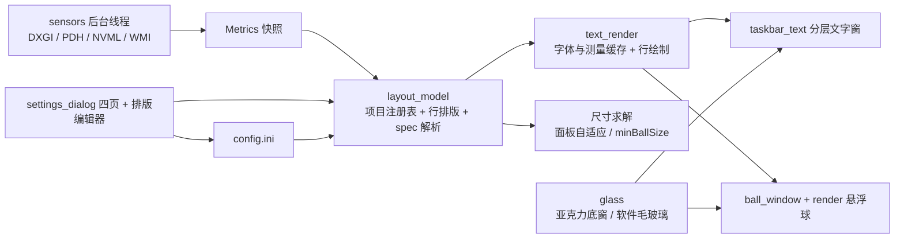

## 用户需求

在现有 NetBall（v1.1.0，Win32 + 任务栏透明文字覆盖窗 + 悬浮球）基础上，把任务栏文字升级为可排版的多指标信息面板，并同步升级悬浮球。

## 产品概览

任务栏右侧出现一块可双行排版的信息面板，展示网速、内存、CPU/GPU 负载与温度；悬浮球变成一个宽高可调、支持多行排版的信息块。两处共用同一套“项目 + 行”的排版模型和同一套材质系统，可切换系统亚克力、自绘毛玻璃、半透明纯色等外观。

## 核心功能

- **指标扩充**：下行、上行、内存、CPU 负载、CPU 温度、GPU 负载、GPU 温度；GPU 按卡独立成项，最多 4 张，逐卡选择。
- **自定义排版**：项目可增删、可上移下移；每个项目可指定所属行，行内按列表顺序排列，项目间用可配置间距分隔；行数不超过项目数、每行至少 1 项；任务栏最多 2 行，悬浮球行数仅受项目数限制。
- **字体可调**：字号、行间距、项目间距分别可调；任务栏提供“字号自适应任务栏高度”选项，悬浮球提供“字号自适应”。
- **尺寸规则**：任务栏面板由内容自适应（宽 = 最宽行 + 内边距，高 = 行数 × 行高 + 内边距），内容高于任务栏时向上凸出；悬浮球宽、高独立可调，下限为当前字号下内容实际占用，低于下限自动抬升。
- **高级材质**：无 / 亚克力 / 毛玻璃 / 半透明纯色，可调色调、色调透明度、模糊半径、圆角、描边、阴影；系统不支持透明效果或调用失败时自动回退到自绘毛玻璃。
- **温度数据源可选**：自动 / 系统接口 / 外部 LibreHardwareMonitor / 关闭；不可用时显示“--”，不伪造数值；设置窗展示探测到的 GPU 列表。
- **设置窗改版**：分页（常规 / 任务栏 / 悬浮球 / 材质与数据源），内含排版编辑器与即时预览。
- **性能**：传感器后台采样、界面空闲不重绘、模糊结果缓存，内存与 CPU 占用保持同一量级。

## 技术栈

- 语言与构建：C++17，MinGW-w64 g++ 13.1，`-O2 -s -municode -mwindows`，`-static` 全静态，无第三方库与运行时依赖。
- 绘制：GDI+（文字、形状、软件模糊），DWM（亚克力合成），分层窗口 `UpdateLayeredWindow`（现有 per-pixel alpha 路径保持不变）。
- 采集：`GetSystemTimes`（CPU 负载）、PDH `\GPU Engine(*)\Utilization Percentage`（GPU 负载）、DXGI（显卡枚举）、NVML / ADL（GPU 温度，动态 `LoadLibrary`）、WMI COM（ACPI 热区、外部 LibreHardwareMonitor）。
- 新增链接项：`-lpdh -ldxgi -lwbemuuid`（`ole32/oleaut32` 已有）。`.bat` 保持纯 ASCII。

## 总体架构

现有分层保持不变，新增三个可复用模块，宿主层只做“取快照 → 排版 → 画”。



## 关键实现决策

### 1. 排版模型（唯一真源）

- 项目注册表：`token → {中文名, 取值函数, 单位/前缀}`，token 固定为 `down, up, mem, cpuload, cputemp, gpu0load, gpu0temp … gpu3load, gpu3temp`（共 13 项）。
- 序列化格式：`'/'` 分行、`','` 分项目，如 `down,up/cpuload/gpu0temp`。字符串同时编码“启用集合、行归属、行内顺序”三件事，一个 ini 键即可完整表达。
- 归一化规则（`layout_model::normalize`）：丢弃未知 token 与重复 token；删除空行并压实行号；行数不超过项目数；任务栏超过 2 行时把溢出项目并入第 2 行；无任何有效项目时回落该表面默认值。
- 默认值：任务栏 `down,up`（等价 v1.1 默认表现）；悬浮球 `down/up/mem`（等价 v1.1 三行表现），保证升级后零视觉回归。
- `layout_model::clampConfig(AppConfig*, Surface)` 统一做取值范围校验，替换目前 `ball_window.cpp` / `taskbar_text.cpp` / `settings_dialog.cpp` 三处各自为政的 `ClampConfig`（DRY）。

### 2. 数据采集

| 指标 | 来源 | 频率 | 执行位置 | 单次开销 |
| --- | --- | --- | --- | --- |
| 网速 | `GetIfTable2`（沿用现有去重口径） | refreshMs | UI 线程 | 约 0.2~0.5 ms |
| 内存 | `GlobalMemoryStatusEx` | refreshMs | UI 线程 | 小于 0.01 ms |
| CPU 负载 | `GetSystemTimes` 差分，busy=(kernel+user-idle)/(kernel+user) | 1 s | UI 线程 | 小于 0.01 ms |
| GPU 负载 | PDH 通配计数器 + 实例名解析 `pid_*_luid_0x….`，按 LUID 汇总后钳制 100 | 1 s | 后台线程 | 约 0.5~1 ms |
| GPU 温度 | NVML（随驱动）→ ADL（尽力而为）→ 外部 LHM | 3 s | 后台线程 | NVML 小于 0.1 ms |
| CPU 温度 | WMI `root\WMI:MSAcpi_ThermalZoneTemperature` → 外部 LHM | 5 s | 后台线程 | RPC 延迟 10~200 ms，不占本进程 CPU |


- 后台线程：`CreateEvent` 驱动、单线程、`WaitForSingleObject` 超时轮询；`CoInitializeEx(COINIT_MULTITHREADED)` 只在线程内；`WM_DISPLAYCHANGE` 时用 `IDXGIFactory1::IsCurrent()` 判断是否需要重扫显卡。
- 失败退避：WMI/ADL 失败后 30 s 内不再重试并置无效，避免每次采样都等 RPC；成功一次后恢复正常周期。
- 快照发布：后台线程写 `Metrics`（互斥保护），`metrics::sample()` 合并网速/内存/CPU 后返回；UI 线程绝不直接调用 PDH/NVML/WMI。
- 无效语义：`cpuPercent = -1`、`gpuLoad[i] = -1`、`cpuTempValid/gpuTempValid = FALSE`，渲染层统一显示 `--`。

### 3. 文字渲染与脏检查

- `text_render` 持有 `Font` 缓存（key = 家族|px|weight，按 DPI 版本号整体失效）、复用 `StringFormat`/`Graphics`、宽度缓存（key = 文本内容 + px），消除现在 `MeasureLine()` 每次新建 `Bitmap(1,1)`+`Font` 的热点。
- 视觉沿用现状：低对比度时四向反色光晕 + 0.6 px 叠加加粗；高对比度时只画一遍正文，降低绘制次数。
- 脏检查：`布局指纹 = spec + 字号 + 行距 + 间距 + 颜色 + 尺寸`、`文本指纹 = 逐项格式化结果`；两者都未变则不触碰 `UpdateLayeredWindow`。
- 数字变化才重绘：每行项目文本单独格式化，避免整块重排（尺寸未变时只重画 DIB）。

### 4. 材质系统

- 亚克力路径：为每个表面单独创建一块**非分层**底窗（`WS_EX_TOOLWINDOW|TOPMOST|NOACTIVATE|TRANSPARENT`），`SetWindowCompositionAttribute(ACCENT_ENABLE_ACRYLICBLURBEHIND, GradientColor)`；失败再尝试 `DwmSetWindowAttribute(DWMWA_SYSTEMBACKDROP_TYPE = DWMSBT_TRANSIENTWINDOW)`；再失败回退软件毛玻璃。文字层仍在底窗之上，靠 `SetWindowPos(textHwnd, glassHwnd, …)` 维持 z 序。
- 能力探测：`RtlGetVersion` 版本、`DwmIsCompositionEnabled`、`HKCU\…\Themes\Personalize\EnableTransparency`；任一不满足直接走回退，不做无谓调用。
- 软件毛玻璃：隐藏自身窗口 → `GetDC(NULL)`+`BitBlt` 抓背后 → 可分离盒式模糊 3 次（近似高斯）→ 色调叠加 → 64×64 噪点平铺 → `GraphicsPath` 圆角裁剪 → 1 px 内高光 + 外描边 + 可选投影。结果按 `(矩形, 半径, 色调, 透明度, 主题)` 缓存，仅在几何/材质/主题变化时重算；实测 600×110 区域单次小于 1.5 ms。
- 亚克力窗圆角用 `SetWindowRgn(CreateRoundRectRgn)`，锯齿由文字层的 1 DIP 内描边遮盖；圆角半径 = 系统默认 8 DIP 时优先用 `DWMWA_WINDOW_CORNER_PREFERENCE`。

### 5. 尺寸与形状

- `minBallSize(cfg, dpi, blockW, blockH)`：椭圆用闭式解（宽高比与内容一致时 w = blockW·√2、h = blockH·√2），否则做最多 24 次的有界扩张迭代；只在配置/字体变化时算一次。
- 形状语义扩展：0 = 椭圆（等宽高时为圆）、1 = 圆角方（r = min(w,h)·0.22）、2 = 胶囊（r = min(w,h)/2）；`HalfWidthAt()` 相应支持椭圆与任意宽高。
- 任务栏定位：横向任务栏右缘 = `TrayNotifyWnd.left - gap`，底对齐 `bar.bottom`（任务栏在顶部时顶对齐 `bar.top` 反向生长），高度可越出任务栏；纵向任务栏维持多行堆叠兜底，放不下则隐藏。

### 6. 性能预算（相对 v1.1 基线 WS 3.67 MB / CPU 0.021%）

- 空闲路径：250 ms `sync()` 仅 1 次 `FindWindowEx` + 2 次 `GetWindowRect` + 整数比较，无绘制、无分配。
- 稳态新增：1 s 采样约 0.5 ms、后台 PDH 约 1 ms/s、温度 3~5 s 一次；目标新增 CPU ≤ 0.05%，整体稳态 ≤ 0.1%。
- 内存：面板 DIB + 1 张全尺寸模糊中转缓冲 + 球体 DIB，按尺寸复用；启动后沿用现有 `SetProcessWorkingSetSize` 单次回收，目标 WS ≤ 15 MB、Private ≤ 8 MB。
- 禁止项：绘制路径内 `new`/`CreateFont`/`CreateDIBSection`（仅在尺寸变化时重建）；温度查询不得进 UI 线程。

## 关键代码结构

```cpp
#define NETBALL_MAX_GPU     4
#define NETBALL_MAX_ITEMS   (5 + NETBALL_MAX_GPU * 2)   /* 13 */
#define NETBALL_MAX_TB_ROWS 2
#define NETBALL_SPEC_CCH    160

struct AppConfig {
    /* v1.0 / v1.1 既有字段保持不变 */

    wchar_t  tbLayout[NETBALL_SPEC_CCH];    /* 默认 L"down,up"，'/' 分行、',' 分项目 */
    wchar_t  ballLayout[NETBALL_SPEC_CCH];  /* 默认 L"down/up/mem" */

    int      tbFontPx;      /* 0 = 自适应任务栏高度；否则 10..48 DIP */
    int      tbLinePct;     /* 100..220 行距百分比 */
    int      tbItemGap;     /* 0..48 DIP 项目间距 */
    int      ballFontPx;    /* 0 = 自适应球高；否则 8..48 */
    int      ballLinePct;
    int      ballItemGap;

    int      ballW, ballH;  /* 40..400 DIP，下限由排版引擎抬升 */

    int      tbMat, ballMat;        /* 0 无 1 亚克力 2 毛玻璃 3 纯色 */
    COLORREF tbTint; int tbTintAlpha;
    int      matBlur;       /* 0..40 px */
    int      matCorner;     /* 0..40 DIP */
    BOOL     matBorder, matShadow;

    int      tempSrc;       /* 0 自动 1 系统 2 外部 LHM 3 关闭 */
};

struct Metrics {
    /* 既有 upBps/downBps/memPercent/memUsed/memTotal/netValid 不变 */
    int      cpuPercent;                  /* -1 无效 */
    int      cpuTempC; BOOL cpuTempValid;
    int      gpuCount;                    /* 0..NETBALL_MAX_GPU */
    int      gpuLoad[NETBALL_MAX_GPU];    /* -1 无效 */
    int      gpuTemp[NETBALL_MAX_GPU]; BOOL gpuTempValid[NETBALL_MAX_GPU];
    wchar_t  gpuName[NETBALL_MAX_GPU][64];
};

namespace layout_model {
    enum Surface { SURF_TASKBAR = 0, SURF_BALL = 1 };
    int  parse(const wchar_t* spec, int maxRows, int* rowOfItem, int* itemCount);
    void format(const int* rowOfItem, int itemCount, wchar_t* out, int cch);
    void normalize(int maxRows, int* rowOfItem, int* itemCount);
    void clampConfig(AppConfig* c, Surface s);
    void defaults(AppConfig* c, Surface s);
    void minBallSize(const AppConfig* c, const Metrics* m, int dpi, int* w, int* h);
}

namespace sensors {
    bool start(const AppConfig* c);
    void stop();
    void setConfig(const AppConfig* c);
    void get(Metrics* out);          /* 合并到调用方 Metrics，线程安全 */
    bool gpuInfo(int index, wchar_t* name, int cch);
    void rescanGpus();               /* WM_DISPLAYCHANGE 时调用 */
}

namespace glass {
    void  probe();                                   /* 能力探测，进程内缓存 */
    bool  ensure(int slot, HWND textHwnd);           /* 0=taskbar 1=ball */
    void  place(int slot, const RECT& rc, int radiusDip, COLORREF tint, int alpha);
    void  hide(int slot);
    void  invalidate();                              /* 几何/主题变化，丢弃模糊缓存 */
    bool  drawFrost(void* argbBits, int stride, int w, int h, const RECT& screenRect);
}
```

## 配置键

| 键 | 范围 | 默认 | 说明 |
| --- | --- | --- | --- |
| `tblayout` | spec | `down,up` | 任务栏排版，最多 2 行 |
| `balllayout` | spec | `down/up/mem` | 悬浮球排版 |
| `tbfont` | 0 或 10..48 | 0 | 0 = 按任务栏高度自适应 |
| `tblinepct` / `tbitemgap` | 100..220 / 0..48 | 118 / 8 | 行距 / 项目间距 |
| `ballfont` / `balllinepct` / `ballitemgap` | 同上 | 0 / 118 / 6 | 悬浮球排版参数 |
| `ballw` / `ballh` | 40..400 | 由 `size` 迁移 | 独立宽高（胶囊按 1.5 倍高迁移） |
| `tbmat` / `ballmat` | 0..3 | 1 / 0 | 材质种类 |
| `tbtint` / `tbtintalpha` | #RRGGBB / 0..100 | #181B22 / 55 | 任务栏材质色调 |
| `matblur` / `matcorner` | 0..40 / 0..40 | 16 / 12 | 模糊半径 / 圆角 |
| `matborder` / `matshadow` | 0/1 | 1 / 1 | 描边 / 投影 |
| `tempsrc` | 0..3 | 0 | 温度数据源 |


兼容策略：`cfg::load()` 缺键回落默认；`tblayout` 缺失时由 `tbshowdown/tbshowup/tbshowmem` 生成，`balllayout` 缺失时由 `shownet/showmem` 生成；`ballw/ballh` 缺失时由 `size`+`shape` 推导；`cfg::save()` 同步派生写回旧键，保证降级到 v1.1 仍有合理表现。

## 目录结构

```
网速悬浮球/
├── src/
│   ├── app_common.h            [MODIFY] 扩展 AppConfig/Metrics、新增常量、版本改 1.2.0
│   ├── layout_model.h          [NEW] 项目 ID/注册表、Surface、spec 解析与归一化、clampConfig、minBallSize 声明
│   ├── layout_model.cpp        [NEW] 13 项项目注册表与取值格式化、CSV spec 编解码、行压实、默认值与 v1.1 迁移、尺寸求解
│   ├── sensors.h               [NEW] 后台采样线程对外接口（start/stop/setConfig/get/gpuInfo/rescanGpus）
│   ├── sensors.cpp             [NEW] DXGI 枚举、PDH GPU 负载解析、NVML/ADL 动态加载、WMI ACPI 与外部 LHM 温度、失败退避、快照发布
│   ├── text_render.h           [NEW] 文字块引擎接口：Block 结构、measure、draw、缓存失效
│   ├── text_render.cpp         [NEW] GDI+ Font/StringFormat/宽度缓存、按行绘制、光晕与加粗、内容尺寸计算
│   ├── glass.h                 [NEW] 材质接口：probe/ensure/place/hide/invalidate/drawFrost
│   ├── glass.cpp               [NEW] 亚克力底窗生命周期、DWM 调用探测与降级、软件毛玻璃（捕获/模糊/噪点/圆角/描边/投影）与缓存
│   ├── render.h                [MODIFY] 补充材质与排版相关渲染入口说明
│   ├── render.cpp              [MODIFY] 形状支持任意宽高、按 layout_model 取行、文字改走 text_render、材质填充
│   ├── ball_window.cpp         [MODIFY] 宽高替代 size、最小尺寸钳制、脏检查扩展到 CPU/GPU、玻璃底窗随动
│   ├── taskbar_text.cpp        [MODIFY] 双行排版、自适应尺寸、可凸出任务栏、材质、z 序与脏检查
│   ├── settings_dialog.cpp     [MODIFY] 四页标签、排版编辑器（列表 + 添加/移除/上移/下移/换行）、材质与数据源页、预览
│   ├── config.cpp              [MODIFY] 新键读写、spec 校验、旧键派生写回与迁移
│   ├── metrics.cpp             [MODIFY] 增加 CPU 负载差分，合并 sensors 快照
│   ├── main.cpp                [MODIFY] sensors 启停与重扫、WM_DISPLAYCHANGE/主题变化转发、退出顺序
│   ├── tray.cpp                [MODIFY] 提示文本纳入 CPU/GPU（128 字符截断保护）
│   ├── app.rc                  [MODIFY] FILEVERSION/PRODUCTVERSION/FileVersion/ProductVersion/IDS_VERSION = 1.2.0
│   └── app.manifest            [MODIFY] assemblyIdentity version = 1.2.0.0
├── build/
│   ├── build.bat               [MODIFY] 编译单元追加 sensors/layout_model/text_render/glass，链接追加 -lpdh -ldxgi -lwbemuuid
│   └── package.bat             [MODIFY] 版本号、OUTEXE、EXPECT_SIZE/EXPECT_SHA（最终构建后回填）
├── installer/
│   └── NetBall.iss             [MODIFY] 注释、MyAppVersion、VersionInfoVersion、OutputBaseFilename = 1.2.0
├── assets/installer/
│   └── README.txt              [MODIFY] 版本号与新增功能/数据源说明（UTF-8 BOM + CRLF）
├── docs/
│   ├── v1.2.0-变更与升级说明.md  [NEW] 变更、配置兼容、界面、性能实测、已知限制（沿用 v1.1 文档结构）
│   └── verify/v1.2/measure.ps1  [NEW] 60 s CPU/WS/句柄采样 + 任务栏与悬浮球截图回归
```

## 实现要点与风险控制

- **契约与兼容**：`AppConfig`/`Metrics` 只增字段不改既有语义；`cfg::load/save` 保持“非法值回落默认、不截断”的既有风格；`size` 键保留只读迁移，不删除。
- **热路径**：`text_render` 的字体与宽度缓存必须有失效入口（DPI/字体参数变化），否则改字号不生效；`glass` 模糊缓存的 key 必须包含主题与 DPI。
- **错误处理**：所有传感器与 DWM 调用失败只降级显示，不允许影响绘制或阻塞消息循环；后台线程退出需 `SetEvent` + `WaitForSingleObject` 限时 join，并在 `GdiplusShutdown` 之前完成。
- **分层窗口约束**：DIB 必须是 top-down 32bpp，GDI+ `Bitmap` 的 stride 用 `GetObject` 实测值；`UpdateLayeredWindow` 失败时隐藏而不是保留脏帧。
- **亚克力回退**：必须实现“强制软件模糊”开关用于回归测试；`EnableTransparency = 0`、远程桌面、DWM 关闭三种情况都要实测走回退路径。
- **日志**：不引入日志框架，不写盘；调试期用 `OutputDebugStringW` 输出传感器失败原因（发布版保留但不含用户数据）。
- **多 GPU 映射已知限制**：NVML 索引与 DXGI LUID 无法可靠一一对应，采用“同厂商内 PCI 序 + 枚举序”匹配，单卡精确；外部 LHM 通过 `Identifier`（如 `/gpu-nvidia/0`）精确映射。该项写入文档“已知限制”。

## 设计方向

设置窗从单页表单升级为四页结构的原生深色面板，延续现有 `kDlgBg/kPanelBg/kAccent` 配色与自绘按钮语言，不引入任何 UI 框架；信息密度优先，所有控件保持 26 DIP 行高节奏。

## 页面结构与布局

- 客户区 420×524 DIP：顶部 36 DIP 自绘标签条（常规 / 任务栏 / 悬浮球 / 材质与数据源），选中页签底部 2 DIP 强调色下划线；页面区 40~452 DIP；底部 464~496 DIP 放「恢复默认 / 取消 / 保存」。
- 标签条与预设色块一样由父窗口自绘 + `WM_LBUTTONDOWN` 命中测试，不使用原生 Tab 控件，避免破坏深色一致性。
- 每页统一「左标签 72 DIP + 右控件区」两栏网格，8 DIP 间距；滑杆右侧固定 56 DIP 数值列，避免拖动时文字跳动。

## 排版编辑器

- 任务栏页与悬浮球页共用同一编辑器：上方只读摘要（`行 2/2 · 项目 5`），中部 `LISTBOX`（26 DIP 行高）逐行显示「行1 · 下行速度」，选中行整条高亮为 `kAccent` 12% 淡底 + 左侧 2 DIP 竖条。
- 下方五个按钮：添加项目（弹出按类别分组的菜单）、移除、上移、下移、移到下一行；不可用状态自动置灰（例如最后一行不能继续下移）。
- 任何编辑操作立即调用 `layout_model::normalize` 并刷新摘要与右侧预览，不合法状态（空行、超出 2 行）直接在按钮层禁用，不给用户制造错误。

## 材质与观感

- 预览区展示真实材质小样：亚克力用冷灰底 + 顶部 1 px 白色 8% 高光 + 外侧 1 px 白色 6% 描边；毛玻璃叠 3% 噪点；纯色底板带内阴影。
- 任务栏面板默认圆角 12 DIP、描边开启、投影关闭亮度干扰，文字保持现有反色柔光；低对比度时才出现光晕，避免常驻“毛边”。
- 交互微反馈：按钮 hover 提亮 6%、按下变暗 8%，滑杆拖动时预览即时刷新但不重建窗口。

## 字体

标题 13 px / 600，正文与控件 12 px / 400，数值与等宽数字使用 `Segoe UI`，中文回退 `Microsoft YaHei UI`；全部经 DPI 缩放，不出现半像素字号。

## 色彩

沿用现有深色体系：底色 #202228、面板 #2B2E37、分隔线 #383C46、强调色 #3A7EEB，正文 #E6E9F0、次要文字 #9196A3；成功/警告/错误仅用于数据源状态与校验提示。